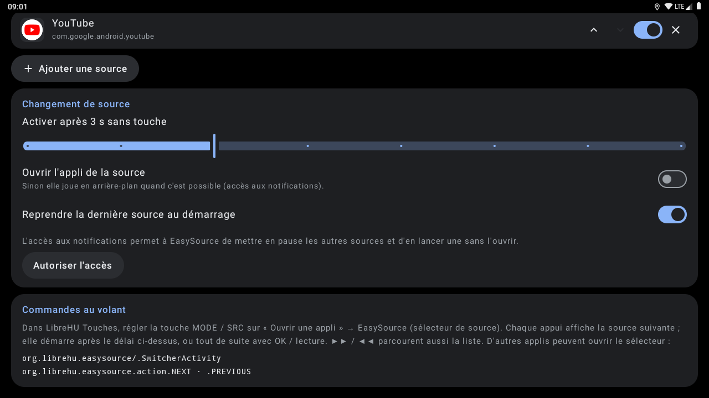
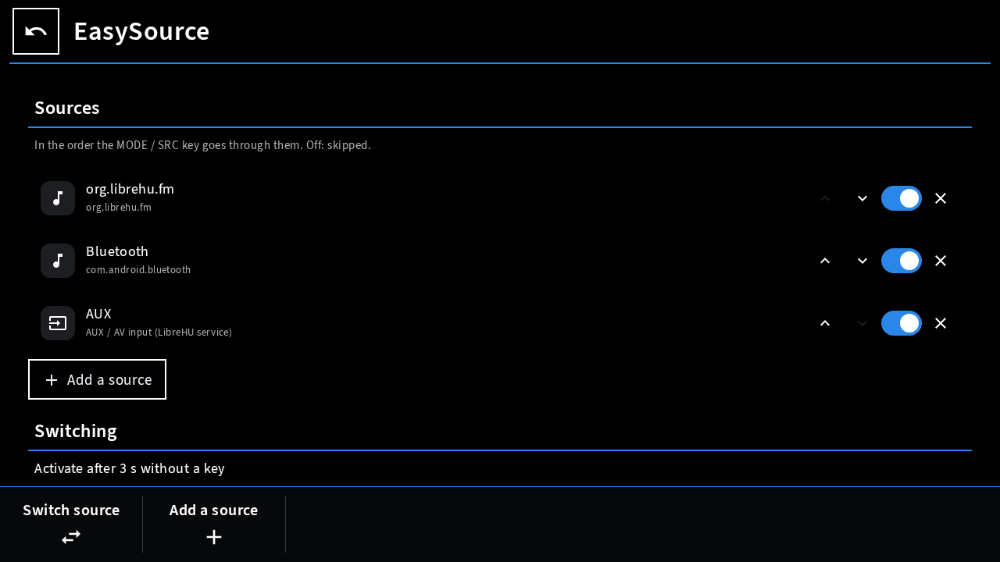
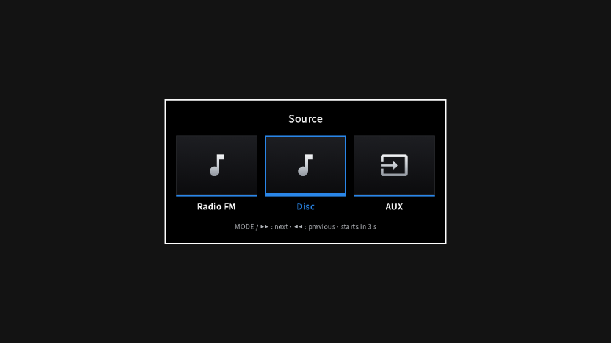
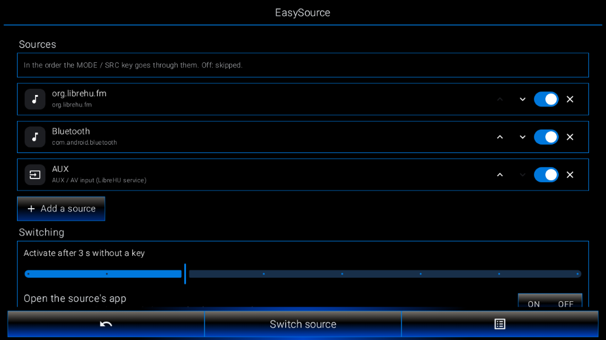
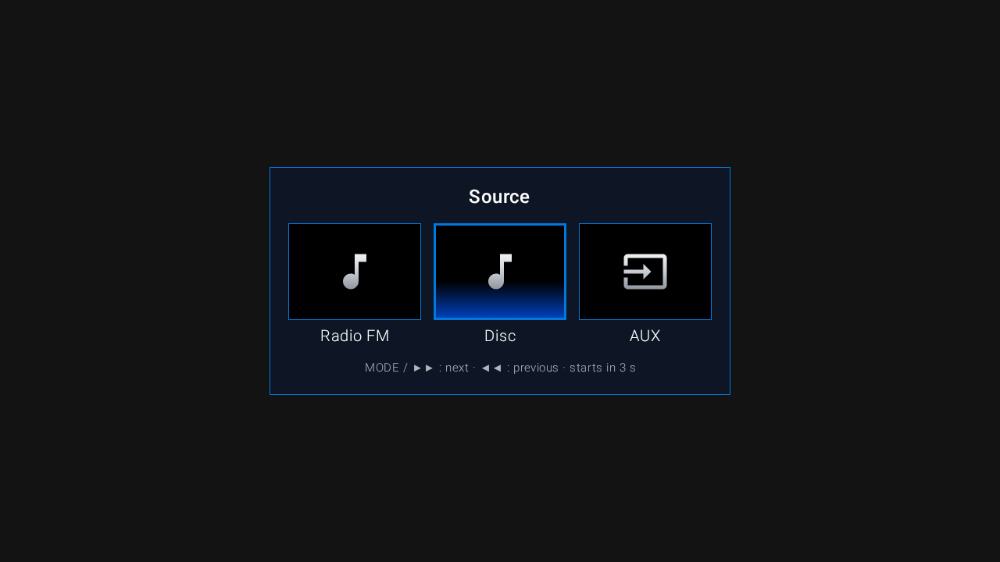

# LibreHU EasySource

Changer de source d'un appui au volant, sur autoradios Jancar / Autochips AC8257 (UJC201) : radio FM, musique
Bluetooth, entrée AUX, applis de musique… Thème clair / sombre et couleur d'accent de
[LibreHU Launcher](https://github.com/LibreHU/LibreHU-Launcher-App).

- **Sélecteur** plein écran par-dessus l'appli en cours, grandes tuiles : chaque appui sur **MODE / SRC** affiche la
  source suivante, qui démarre après quelques secondes sans touche (réglable) ou tout de suite avec OK / lecture ;
  ▶▶ / ◀◀ parcourent aussi la liste, ▶‖ valide ; au toucher, une tuile démarre aussitôt. **Molette du volant** :
  les touches du volant que LibreHU-service transforme en touches média (▶▶ / ◀◀ / ▶‖) partent vers les sessions
  média, pas vers la fenêtre du sélecteur ; tant que le sélecteur est affiché, il le dit au service
  (`org.librehu.service.SOURCE_SWITCHER`), qui les lui envoie (`org.librehu.easysource.action.KEY`) : on fait défiler
  à la molette au lieu d'appuyer plusieurs fois sur SRC.
- **Sources** : LibreHU FM, Bluetooth (A2DP de `com.android.bluetooth`), **entrée AUX** (source audio
  « aux » de [LibreHU-service](https://github.com/LibreHU/LibreHU-service)), et les applis média trouvées comme le
  fait Android Auto (`MediaBrowserService`) ou n'importe quelle appli ; ordre, activation et ajout dans l'appli.
- **Changement** : les autres sessions média sont mises en pause, l'entrée de la puce audio repasse sur Android (ou
  AUX), puis la source démarre par sa session média, en arrière-plan, ou en ouvrant l'appli (option). L'accès aux
  notifications est nécessaire pour voir les sessions des autres applis.
- **Android Auto / CarPlay** (Open Headunit LibreHU ou d'origine, xcertplay LibreHU ou d'origine) : toujours ouverts
  au premier plan, quel que soit le réglage « ouvrir l'appli » (une projection est un écran : sa session média seule
  ne montrait rien), sans commande de lecture ; Open Headunit reçoit ensuite `ACTION_RAISE_PROJECTION` par son
  récepteur d'automatisation (celui du fork LibreHU demande la permission de signature `CONFIGURE`), qui remet la
  projection devant quand un téléphone est connecté.
- **Reprise au démarrage** de la dernière source (option).

## Captures d'écran

| | |
|---|---|
| <br>Réglages | <br>Réglages (2) |
| <br>Style Modularer Infotainment-Baukasten | <br>Sélecteur, style Modularer Infotainment-Baukasten |
| <br>Style LHU-Link | <br>Sélecteur, style LHU-Link |

Captures sur l'émulateur Android 9 (1280×720, 160 dpi comme l'autoradio), sans autoradio branché : les valeurs du véhicule et de la MCU sont vides. Refaites-les avec l'action **Screenshots** de [LibreHU-OTA-app](https://github.com/LibreHU/LibreHU-OTA-app/tree/main/screenshots). Galerie : [librehu.github.io/screenshots/easysource.html](https://librehu.github.io/screenshots/easysource.html).

## Sur une touche du volant

Avec [LibreHU BtnRemap](https://github.com/LibreHU/LibreHU-BtnRemap-app) : touche MODE / SRC → « Ouvrir une appli »
→ **EasySource (sélecteur de source)**. D'autres applis peuvent démarrer le sélecteur :

```
am start -a org.librehu.easysource.action.NEXT        # source suivante
am start -a org.librehu.easysource.action.PREVIOUS    # source précédente
```

Non testé sur l'autoradio à ce stade.

## Appli téléphone (LibreHU Bridge)

Réglable depuis le téléphone par l'appli LibreHU Bridge (Android et iPhone), à travers LibreHU-service : la source jouée, les sources (marche, ordre), le délai, l'ouverture de l'appli et la reprise au démarrage.
Fournisseur `<paquet>.bridge` (`bridge/BridgeProvider.kt`), réservé aux applis signées avec la clé LibreHU (permission
`org.librehu.permission.BRIDGE`, vérifiée dans `call()` lui-même) ; format décrit dans
[LibreHU-service, docs/bridge.md](https://github.com/LibreHU/LibreHU-service/blob/main/docs/bridge.md).

## Optimisation (R8)

L'APK publié par la CI (`assembleRelease`) est **optimisé par R8** : code et ressources réduits et optimisés, ce qui
rend Jetpack Compose nettement plus fluide ([Compose performance](https://developer.android.com/develop/ui/compose/performance)),
**sans renommage** (`-dontobfuscate` dans `app/proguard-rules.pro`) : les traces des journaux restent lisibles. Les
règles gardent aussi ce qui n'est appelé que par son nom (méthodes natives, helpers root lancés par `app_process`). Si
une fonction plante avec « class / method not found », regarder `usage.txt` dans l'artefact *R8 reports* de la CI (ce
que R8 a retiré) et ajouter une règle `-keep`.

**Styles Modularer Infotainment-Baukasten et LHU-Link de LibreHU Launcher** : c'est le launcher qui les choisit et les demande à l'appli (il publie `style` = `factory` ou `ambient`, comme pour le style rétro) ; l'appli suit tout de suite : palette noire du style même en mode jour, coins carrés partout, police Source Sans 3 pour Modularer Infotainment-Baukasten (SIL OFL 1.1, `third_party/SourceSans3-LICENSE.md`), lettres fines pour LHU-Link. Rien à régler dans l'appli.

**Son des touches** : chaque toucher (sans glisser ni appui long) fait un petit son qui suit le style que LibreHU
Launcher demande à l'appli : tic doux (moderne), bip d'autoradio (rétro), « toc » amorti (Modularer
Infotainment-Baukasten), bip électronique montant (LHU-Link). Sons propres à LibreHU, synthétisés (`res/raw/click_*.wav`,
`ui/KeyClick.kt`) ; coupé quand les « Sons des touches » d'Android sont désactivés (Paramètres → Son).

Les écrans prennent aussi la **mise en page** de ces styles (éléments communs dans `ui/CarKit.kt`) : réglages dans le
cadre du style (**Modularer Infotainment-Baukasten** : Retour encadré, titre sur un trait de la couleur d'accent,
groupes titrés, interrupteurs en barres gris clair à case carrée, touches encadrées, touches du bas « Changer de
source » et « Ajouter une source » ; **LHU-Link** : titre, groupes encadrés, interrupteurs ON | OFF à trait rouge,
barre du bas Retour / Changer de source / Options) ; le **sélecteur de source** en tuiles d'usine (trait d'accent,
choix encadré) ou en tuiles encadrées éclairées par le bas. Aucun logo, nom, icône, police ni image d'un constructeur.

**Style rétro et police de LibreHU Launcher** : quand le launcher est en style rétro (les couleurs d'un afficheur
d'autoradio tirées de sa couleur d'accent, couleur RGB comprise), cette appli prend sa palette (jour ou nuit) ; quand
la **police d'afficheur à segments** y est choisie (dans tous les styles), cette appli la prend aussi, en majuscules
sans accents (« LibreHU Seg14 », tirée de DSEG14 © keshikan, SIL Open Font License 1.1, voir
`third_party/DSEG-LICENSE.txt`). Le launcher publie le style, la police et la palette par
`content://org.librehu.launcher.theme/theme` (colonnes `style`, `font`, `background`, `surface`, `surface_high`,
`on_accent`, `text`, `text_dim`) et par la diffusion `org.librehu.action.THEME_CHANGED` (mêmes noms en extras).

## Soutenir le projet

LibreHU est développé bénévolement, sur le temps libre, et toutes ses applis restent gratuites. Si le projet vous est
utile, vous pouvez le soutenir par un don sur [Liberapay](https://liberapay.com/DokT/donate) (association française à
but non lucratif, dons récurrents) :

[](https://liberapay.com/DokT/donate)
[](https://liberapay.com/DokT/)
