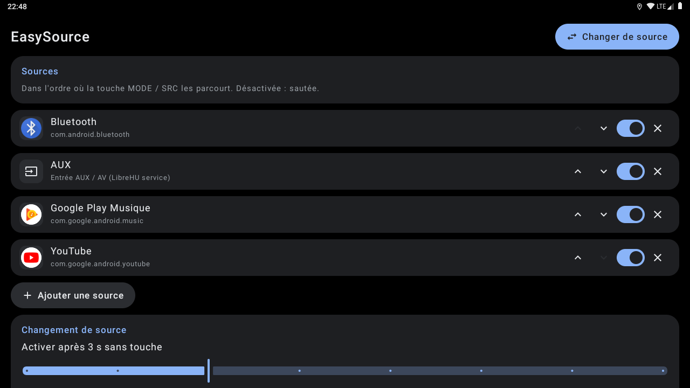

# LibreHU EasySource

Changer de source d'un appui au volant, sur autoradios Jancar / Autochips AC8257 (UJC201) : radio FM, musique
Bluetooth, entrée AUX, applis de musique… Thème clair / sombre et couleur d'accent de
[LibreHU Launcher](https://github.com/LibreHU/LibreHU-Launcher-App).

- **Sélecteur** plein écran par-dessus l'appli en cours, grandes tuiles : chaque appui sur **MODE / SRC** affiche la
  source suivante, qui démarre après quelques secondes sans touche (réglable) ou tout de suite avec OK / lecture ;
  ▶▶ / ◀◀ parcourent aussi la liste, ▶‖ valide ; au toucher, une tuile démarre aussitôt. **Molette du volant** :
  les touches du volant que LibreHU-service transforme en touches média (▶▶ / ◀◀ / ▶‖) partent vers les sessions
  média, pas vers la fenêtre du sélecteur ; tant que le sélecteur est affiché, il le dit au service
  (`org.librehu.service.SOURCE_SWITCHER`), qui les lui envoie (`org.librehu.easysource.action.KEY`) : on fait défiler
  à la molette au lieu d'appuyer plusieurs fois sur SRC.
- **Sources** : LibreHU FM, Bluetooth (A2DP de `com.android.bluetooth`), **entrée AUX** (source audio
  « aux » de [LibreHU-service](https://github.com/LibreHU/LibreHU-service)), et les applis média trouvées comme le
  fait Android Auto (`MediaBrowserService`) ou n'importe quelle appli ; ordre, activation et ajout dans l'appli.
- **Changement** : les autres sessions média sont mises en pause, l'entrée de la puce audio repasse sur Android (ou
  AUX), puis la source démarre par sa session média, en arrière-plan, ou en ouvrant l'appli (option). L'accès aux
  notifications est nécessaire pour voir les sessions des autres applis.
- **Android Auto / CarPlay** (Open Headunit LibreHU ou d'origine, xcertplay LibreHU ou d'origine) : toujours ouverts
  au premier plan, quel que soit le réglage « ouvrir l'appli » (une projection est un écran : sa session média seule
  ne montrait rien), sans commande de lecture ; Open Headunit reçoit ensuite `ACTION_RAISE_PROJECTION` par son
  récepteur d'automatisation (celui du fork LibreHU demande la permission de signature `CONFIGURE`), qui remet la
  projection devant quand un téléphone est connecté.
- **Reprise au démarrage** de la dernière source (option).

## Captures d'écran

| | |
|---|---|
| <br>Sources et réglages |  |

Captures sur l'émulateur Android 9 (1280×720, 160 dpi comme l'autoradio), sans autoradio branché : les valeurs du véhicule et de la MCU sont vides. Refaites-les avec l'action **Screenshots** de [LibreHU-OTA-app](https://github.com/LibreHU/LibreHU-OTA-app/tree/main/screenshots).

## Sur une touche du volant

Avec [LibreHU BtnRemap](https://github.com/LibreHU/LibreHU-BtnRemap-app) : touche MODE / SRC → « Ouvrir une appli »
→ **EasySource (sélecteur de source)**. D'autres applis peuvent démarrer le sélecteur :

```
am start -a org.librehu.easysource.action.NEXT        # source suivante
am start -a org.librehu.easysource.action.PREVIOUS    # source précédente
```

Non testé sur l'autoradio à ce stade.

## Optimisation (R8)

L'APK publié par la CI (`assembleRelease`) est **optimisé par R8** : code et ressources réduits et optimisés, ce qui
rend Jetpack Compose nettement plus fluide ([Compose performance](https://developer.android.com/develop/ui/compose/performance)),
**sans renommage** (`-dontobfuscate` dans `app/proguard-rules.pro`) : les traces des journaux restent lisibles. Les
règles gardent aussi ce qui n'est appelé que par son nom (méthodes natives, helpers root lancés par `app_process`). Si
une fonction plante avec « class / method not found », regarder `usage.txt` dans l'artefact *R8 reports* de la CI (ce
que R8 a retiré) et ajouter une règle `-keep`.
